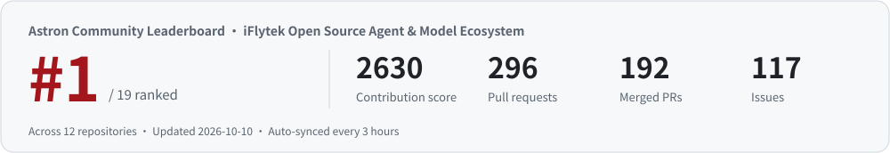

<!-- osai-verify: 47a03548c83092cc7722 -->

<b>English</b> · <a href="https://github.com/FenjuFu/FenjuFu/blob/main/README.zh-CN.md">中文</a>

<picture>
  <source media="(prefers-color-scheme: dark)" srcset="assets/header-dark.svg">
  
</picture>

  
  
  

## 🚀 iFlytek Open Source

<!-- astron-rank:start -->
🥇 **#1 contributor to iFlytek's open-source agent & model ecosystem** · [Astron Community Leaderboard](https://www.awesome-astron-workflow.dev/stats)
<!-- astron-rank:end -->

<a href="https://www.awesome-astron-workflow.dev/stats">
  <picture>
    <source media="(prefers-color-scheme: dark)" srcset="assets/rank-dark.svg">
    
  </picture>
</a>

Projects I help run: [Astron Agent](https://github.com/iflytek/astron-agent)  · [Astron RPA](https://github.com/iflytek/astron-rpa)  · [SkillHub](https://github.com/iflytek/skillhub)  · [Spark-X2.5](https://github.com/XHToken/Spark-X2.5)

| Date | Project | Milestone |
| :-- | :-- | :-- |
| 2026.09.29 | Spark-X2.5 | Passed **1 million** combined downloads (distribution channels + community quantizations / fine-tunes) |
| 2026.09.15 | Astron Agent | Onboarded to Linux Foundation [LFX Insights](https://insights.linuxfoundation.org/project/astron-agent) |
| 2026.09.11 | Spark-X2.5 | Jinsuan Award · Edge Intelligence Innovation Award |
| 2026.09.07 | Spark-X2.5 | **#1 on Hugging Face Trending** |
| 2026.08.28 | Astron Agent | Benchmark AI-Native Application for Manufacturing · 2026 AI-FDE Empowering Manufacturing Conference |
| 2026.07.16 | Astron Agent | Added to the **CNCF Cloud Native Landscape** (AI Native — Workflow Orchestration) |
| 2026.07.14 | SkillHub | Joined the **Agentic AI Foundation (AAIF)** as an Associate Member |
| 2026.05.30 | SkillHub | GitHub Trending #2 |
| 2026.05.20 | Astron Agent | QbitAI "2026 China AIGC Companies & Products to Watch" |
| 2026.04.04 | Astron RPA | GitHub Trending #2 |
| 2026.04.03 | Astron Agent | **GitHub Trending #1** · Repository of the Day |
| 2026.03.28 | Astron RPA | OS2ATC 2026 Best Open-Source Intelligence Breakthrough Award |
| 2026.03 – 08 | SkillHub | OSS Insight global Java trending TOP 5 |
| 2026.02 | Astron Agent | #1 Chinese agent project by OpenRank |
| 2026.01.29 | Astron ecosystem | Gitee 2025 Open Source Projects of the Year · AI TOP 10 |
| 2026.01 – 06 | Astron RPA | OSS Insight global Java trending TOP 10 |
| 2026.01 – 02 | Astron RPA | #1 Chinese RPA project on OpenLeaderboard |
| 2025.09 – 2026.08 | Astron Agent | OSS Insight global Java trending TOP 5 |
| 2025.09 – 2026.01 | Astron Agent | #1 Chinese agent project by OpenLeaderboard activity |

Source: [iFlytek Open Source Milestones](https://opensource.iflytek.com/milestone)

## 🌍 Upstream Contributions

Bringing iFlytek models into open-source ecosystems around the world, and fixing the bugs I run into along the way. Selected merged PRs:

| Area | Merged PRs |
| :-- | :-- |
| 🔌 **Model ecosystem integration** iFlytek Spark / Astron providers | [aaif-goose/goose#9837](https://github.com/aaif-goose/goose/pull/9837) · [dapr/dapr-agents#672](https://github.com/dapr/dapr-agents/pull/672) · [alibaba/open-code-review#485](https://github.com/alibaba/open-code-review/pull/485) · [deepset-ai/haystack-integrations#543](https://github.com/deepset-ai/haystack-integrations/pull/543) · [HKUDS/Vibe-Trading#537](https://github.com/HKUDS/Vibe-Trading/pull/537) · [harry0703/MoneyPrinterTurbo#1531](https://github.com/harry0703/MoneyPrinterTurbo/pull/1531) · [thedotmack/claude-mem#4379](https://github.com/thedotmack/claude-mem/pull/4379) · [TencentCloud/octop-harness#25](https://github.com/TencentCloud/octop-harness/pull/25) |
| 🛠️ **Bug fixes & engineering** C++ / Rust / Go / Python | [fmtlib/fmt#4962](https://github.com/fmtlib/fmt/pull/4962) · [agentgateway/agentgateway#2915](https://github.com/agentgateway/agentgateway/pull/2915) · [agentgateway/agentgateway#2839](https://github.com/agentgateway/agentgateway/pull/2839) · [NVIDIA/SkillSpector#708](https://github.com/NVIDIA/SkillSpector/pull/708) · [longbridge/gpui-kit#3344](https://github.com/longbridge/gpui-kit/pull/3344) · [stablyai/orca#24005](https://github.com/stablyai/orca/pull/24005) · [vectorize-io/hindsight#4927](https://github.com/vectorize-io/hindsight/pull/4927) · [tailscale/tailcat#34](https://github.com/tailscale/tailcat/pull/34) · [abhigyanpatwari/GitNexus#3100](https://github.com/abhigyanpatwari/GitNexus/pull/3100) · [Tencent/teamai-cli#482](https://github.com/Tencent/teamai-cli/pull/482) |
| 🪶 **Apache Software Foundation** | [apache/seatunnel#11664](https://github.com/apache/seatunnel/pull/11664) · [apache/seatunnel#11836](https://github.com/apache/seatunnel/pull/11836) · [apache/fineract-backoffice-ui#533](https://github.com/apache/fineract-backoffice-ui/pull/533) · [apache/fineract-backoffice-ui#540](https://github.com/apache/fineract-backoffice-ui/pull/540) · [apache/magpie#896](https://github.com/apache/magpie/pull/896) |
| 📚 **Docs & tutorials** | [modelcontextprotocol/modelcontextprotocol#2978](https://github.com/modelcontextprotocol/modelcontextprotocol/pull/2978) · [JetBrains/go-modern-guidelines#26](https://github.com/JetBrains/go-modern-guidelines/pull/26) · [trycua/cua#4380](https://github.com/trycua/cua/pull/4380) · [max-sixty/worktrunk#4332](https://github.com/max-sixty/worktrunk/pull/4332) · [pingcap/ossinsight#2897](https://github.com/pingcap/ossinsight/pull/2897) · [datawhalechina/deepagents-in-action#138](https://github.com/datawhalechina/deepagents-in-action/pull/138) |

👉 [All merged PRs](https://github.com/search?q=author%3AFenjuFu+is%3Apr+is%3Amerged&type=pullrequests)

## 🏆 Honors

| Year | Honor |
| :-- | :-- |
| 2026–2027 | Academic Secretary, CCF Women in Computing "Beauty of Computing · Yifang Salon" Academic Committee |
| 2025 | Outstanding Case, CCF Tech for Good Case Collection |
| 2024 · 2025 | Outstanding Case, KAIYUANSHE OpenGood (Open Source for Good) |
| — | Ambassador, CCF Tech for Good and KAIYUANSHE OpenGood |
| 2024 | Core contributor to OpenTenBase, 2nd Prize at the 2024 China Internet Development Innovation & Investment Competition (Open Source) |
| 2024 | Contributor of the Year, Yuanyishi (源译识) |
| 2023 | Open Source Ambassador, OpenAtom Campus Program |

## 🧭 Expertise

       

---

📬 Collaboration, talks, or just a chat: <a href="mailto:fufenjupku@gmail.com">fufenjupku@gmail.com</a>

