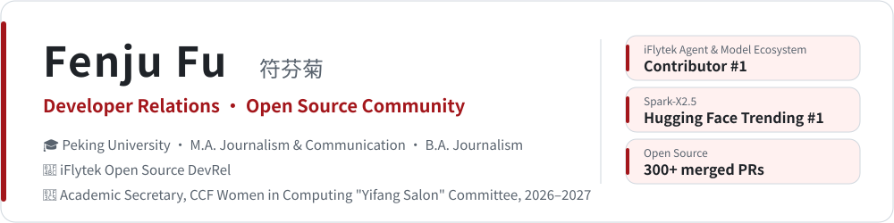
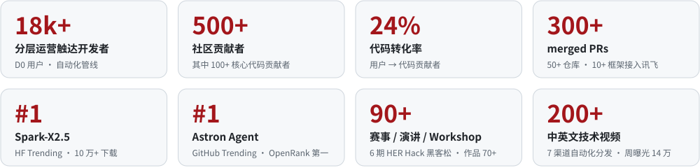
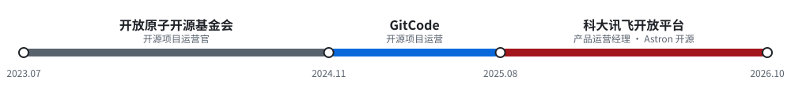

<!-- osai-verify: 47a03548c83092cc7722 -->

<picture>
  <source media="(prefers-color-scheme: dark)" srcset="assets/header-dark.svg">
  
</picture>

  
  
  

> 北大新闻传播出身，3 年开源一线：从**开源基金会**的项目治理，到**代码托管平台**的开发者关系，再到**大厂模型与智能体开源项目**的从 0 到 1 增长。
>
> 既做社区、活动和内容，也自己写代码、提 PR，把讯飞模型接进 10+ 个海内外开源框架。
>
> *DevRel who ships code — community, content, events, and 300+ merged PRs across 50+ repositories.*

## 📊 数字一览 · At a Glance

<picture>
  <source media="(prefers-color-scheme: dark)" srcset="assets/stats-dark.svg">
  
</picture>

## 💼 工作经历 · Experience

<picture>
  <source media="(prefers-color-scheme: dark)" srcset="assets/timeline-dark.svg">
  
</picture>

### 科大讯飞开放平台 · 产品运营经理 &nbsp;`2025.08 – 2026.10`

**模型与智能体开源项目运营**（Astron Agent / Astron RPA / SkillHub / Spark-X2.5）

- 🧑‍💻 **开发者支持**：自动化管线分层运营 18k+ 触达用户（D0）、500+ 社区贡献者（D1）、100+ 核心代码贡献者（D2），代码转化率 **24%**；作为作者贡献 AstronClaw-Tutorial，建设 Awesome-Astron-Workflow 30 案例库与 Astron 智能体社区平台
- 🌱 **开发者社区**：Spark-X2.5 **10 天 Hugging Face Trending #1**、下载破 10 万；Astron Agent **GitHub Trending #1**、OpenRank 中国 Agent 第一、进入 CNCF 云原生全景图；SkillHub 加入 AAIF Associate Member
- 📣 **开发者营销**：开源版 POC 商业化转化 B 端项目；海内外 7 渠道自动化分发内容；策划主办及参与 **90+** 比赛、演讲、Workshop，全案执行 **HER Hack-Astron** 女性开源黑客松 6 期
- 🎤 **开发者布道**：「最忙碌布道师」激励（12 位布道师 30+ 场），沉淀标准化演示材料 16 套，制作中英文视频 **200+**

<b>展开完整经历</b>

 

**模型与智能体开源项目运营**

- **开发者支持**：自动化管线分层运营 18k+ 触达用户（D0）、500+ 社区贡献者（D1）与 100+ 核心代码贡献者（D2），实现 24% 的代码转化率；提供全方位开发者赋能（文档 / 示例代码 / bot / 网站），作为作者贡献 AstronClaw-Tutorial；建设 Awesome-Astron-Workflow 30 案例库与 Astron 智能体社区平台（全球首个企业级智能体开源项目矩阵 Landscape / 贡献统计排行榜 / 贡献积分兑换商城 / 抽奖 / 活动报名 / AI Chat / Zeabur 部署）；通过项目贡献 2.5k+ 优化国内外开发者文档引导与使用体验（仓库 TOP 1 贡献者），推进 Runtime 增强、Memory 优化、MCP Registry、Skill-as-Code、安全治理、AGENTS.md 适配与文档建设；为 Goose、agentgateway、dapr-agents、modelcontextprotocol 等 10+ 项目增加 iFlytek Spark / Astron MaaS 内置 provider，推进讯飞模型生态对外互通；制定 Astron 企业二次开发合规指南，内测后挖掘用户应用场景 20 家、支持案例 14 份
- **开发者社区**：Spark-X2.5 10 天 Hugging Face Trending #1，下载量突破 10 万，获金算奖·端侧智能创新奖；建立项目健康度量体系，Astron Agent Trending #1，OpenLeaderboard 活跃度（2025.9–2026.1）及 OpenRank 值（2026.2）均位列中国 Agent 第一、OSS Insight 全球开源趋势 Java 语言榜单 TOP 5（2025.9–2026.8），进入 CNCF 云原生全景图，申获量子位「2026 中国 AIGC 最值得关注的企业 & 产品」、「2026 AI-FDE 赋能制造业大会」制造业 AI 原生应用标杆；Astron RPA 位列 Trending #2，OpenLeaderboard 中国 RPA 第一（2026.1–2）/ OSS Insight 全球 Java 榜单 TOP 10（2026.1–6），获 OS2ATC 2026 最佳开源智能突破奖；Astron Agent & RPA 获 Gitee 年度开源项目评选「人工智能 TOP 10」；SkillHub 加入 AAIF Associate Member，登 Trending #2，OSS Insight 全球 Java 榜单 TOP 5（2026.3–8）；自动化脚本观测 Star + PR + commit 复合增长指标，流水线生成各时间窗分析、Star 用户画像与运营建议日报；搭建开发者交流社群（23 个 / 3.7k 人），沉淀 4 仓库 FAQ 100+ 与双周报宣传机制
- **开发者营销**：开源版 POC 商业化转化 B 端项目；广告位赞助 + 国内外博主投放 50+，海外曝光超百万；每日根据 GitHub 热点提交优化 issue，海内外 7 渠道自动化分发内容（X / YouTube / 视频号 / Dev.to / 知乎 / Discord / Bluesky）周曝光最高 14 万；策划主办及参与 90+ 比赛、演讲、Workshop 及展位活动，全案执行线上 HER Hack-Astron 女性开源周周黑客松 6 期（作品 70+），线下 GDPS 产业智变黑客松 & 讯飞 1024「Astron 黑客松 2025」（作品 20）；获 Tom Doerr（118k+ 粉丝）、JimmySong 等推荐
- **开发者布道**：拓展行业演讲机会与准备提案，实行开源社区「最忙碌布道师」激励（10 位官方 + 2 位社区布道师 30+ 场布道），沉淀标准化演示材料 16 套；撰写 Astron Agent 部署体验博客及训练营方案，制作中英文视频 200+

**讯飞开放平台活跃**

- **产品功能改进**：用户路径桑基图分析登录后转化路径与关键行为，优化站内信分类规则、首页 & 控制台增加 API 文档直达入口（PV +2.6% / UV +6.8% / UUV +3.9%）；分层运营策略、新手礼包与深度体验引导注册登录（访客登录率 +5.86% / +4.58%），新手指引 Wizard「创建 +50% → 认证 +77% → 领取礼包 +66% → 调用 +49%」
- **平台促活活动**：上线 30 个产品页应用创建弹窗（新用户访问创建率 +7%），PDF & 通用文档 OCR 买一赠一（通用文档识别用户活跃度 +26.9%）
- **平台活跃合作**：制定讯飞开放平台黑客松资源包方案，为开发者赛事提供算力与技术支持；推进「上车智能体时代」主题合作，品牌联动 AI 组织、开源社区 13 家，超算互联网合作拓展智能体生态

### GitCode · 开源项目运营 &nbsp;`2024.11 – 2025.07`

- 🧩 **头部项目开发者关系**：「鸿蒙开发工具大赶集」「2025 码动春天·仓颉三方库开发挑战」等项目创建；仓颉编程语言 / Cangjie Magic 体验征文（投稿 189 篇、阅读 13W+）
- 🏙️ **线下与线上**：主办 openvela 北京沙龙（到场 100+），MateChat / ModelEngine 走进高校与 AI Meetup；运营仓颉任务（成长中心贡献 7k）
- 🎓 **平台生态拓展**：G-Star 校园行建联高校 10 所、建立项目 95 个；Git 开源贡献课程上线 B 站及官网

<b>展开完整经历</b>

 

**头部项目开发者关系**

- **项目创建**：「鸿蒙开发工具大赶集」贡献者 12 人 / PR 65 / 上架 11；「2025 码动春天·仓颉三方库开发挑战」申请 issue 37 / 上架 SIG 33
- **内容创建**：策划仓颉编程语言体验征文（体验 & 下载 99 人 / 投稿 89 篇 / 阅读 8.7W+ / 沉淀博主资源）；Cangjie Magic 体验征文（投稿 100 篇 / 阅读 4.3W+ / 智能体入驻 11）
- **线下 Meetup**：主办 openvela 北京沙龙（到场 100+ / 社群 200 / Star 75 / 曝光 3.9W）；ModelEngine 亮相南京 AI Meetup 及周周黑客松（Star 109）；MateChat 亮相电子科技大学、浙大、GDC 及北京 AI 嘉年华（Star 380+）；于北京 Meetup 结合激励颁发仓颉社区贡献者荣誉 62 位
- **线上渠道**：直播「GitTalk & 开源友的聊」（Star 64）；运营仓颉任务（GitCode 成长中心贡献 7k / CSDN Task 参与 5k & Star 300）
- **策划方案**：制定开源项目 TPC 组织建设 SOP、G-Star Mentorship、头部项目三方库下载量榜单等；设计 OSPO 及社区运营项目分析工具（年报 / 仪表盘 / 周月报）
- **运营支持**：产出 4 份项目运营年报、搭建数据仪表盘及周 / 月报体系；撰写 G-Star 月报 6 篇及 PR 稿件 4 篇；邀请项目代表演讲 30+ 人次；统筹各项目运营规划、产品需求沟通与渠道推广

**平台生态拓展**

- **G-Star 校园行**：建联高校 10 所，建立项目 95 个，校园开发者 150 人
- **培训与赛事**：制作 Git 开源贡献课程上线 B 站及官网；组织线下授课 4 场；合作第三届昆明理工大学程序设计大赛
- **社团与公益**：G-Star 辰星开源社（电科大）组织成员 25 人；G-Star 公益行（线下 2 场 / 线上 1 场），合作公益组织 50+，品牌合作项目 3 个，内容浏览量 9W

### 开放原子开源基金会 · 开源项目运营官 &nbsp;`2023.07 – 2024.11`

- 🏛️ **开源激励**：组织 2023 贡献者 / 开源项目评选（71 个报名、颁发 51 个奖项），收录于 COPU《2024 中国开源发展现状》
- 🌟 **OpenTenBase 重点运营**：推进 TOC 过会、代码仓交割、CLA、商标注册与工委会建设；墨天轮排名 217 → 58，社群 2700 人+；获 2024 中国互联网发展创新与投资大赛（开源）二等奖
- 🤝 **多项目社区运营**：OpenTenBase、OpenKona、OpenCloudOS、TobudOS、MetaToC、Dora SSR 等 6 个项目

<b>展开完整经历</b>

 

**运营部开发者关系**

- **开源激励活动**：组织 2023 贡献者 / 开源项目评选（71 个报名 / 颁发 51 个奖项 / 节省预算 22.5 万 / 曝光 2W+），收录于 COPU《2024 中国开源发展现状》；负责 2024 开发者激励计划及积分榜单制作
- **社区运营**：负责 OpenTenBase、OpenKona、OpenCloudOS、TobudOS、MetaToC、Dora SSR 等 6 个项目的运营；制定 Devpress 工作坊方案，运营 5 个社群（750 人+）

**明星项目 OpenTenBase 重点运营**

- **治理**：推进 TOC 过会、代码仓交割、CLA 签署、商标注册；建立工委会、官网备案及培训认证体系
- **渠道**：运营官网、墨天轮（排名从 217 升至 58）、公众号（0 → 287）、视频号（0 → 902）、社群（2700 人+）
- **活动**：设计活动流程与案例征集（发布 13 篇）；推广开源大赛、开源之夏与校源行（11 场）；拓展校园大使（34 位+）与 8 所开源俱乐部
- **荣誉**：获「2024 中国互联网发展创新与投资大赛（开源）」二等奖、OSCAR 尖峰开源项目

## 🚀 代表项目 · Featured Projects

| 项目 | 简介 | 我的角色 |
| :-- | :-- | :-- |
| [**Astron Agent**](https://github.com/iflytek/astron-agent)    | 企业级智能体工作流平台 | 开源运营 · Trending #1 · 仓库 TOP 1 贡献者 |
| [**Astron RPA**](https://github.com/iflytek/astron-rpa)    | 面向智能体的 RPA 自动化套件 | 开源运营 · Trending #2 · OS2ATC 最佳开源智能突破奖 |
| [**SkillHub**](https://github.com/iflytek/skillhub)    | 企业级自托管 Agent Skill 注册中心 | 开源运营 · Trending #2 · AAIF Associate Member |
| [**AstronClaw-Tutorial**](https://github.com/iflytek/astronclaw-tutorial)    | Astron 智能体上手教程 | 作者 |
| **Spark-X2.5** | 讯飞星火端侧模型 | 开源运营 · Hugging Face Trending #1 · 10 万+ 下载 |

## 🌍 上游开源贡献 · Upstream Contributions

把讯飞模型接进海内外开源生态，顺手修掉沿途遇到的 bug。部分已合并 PR：

| 方向 | 已合并 PR |
| :-- | :-- |
| 🔌 **模型生态互通** iFlytek Spark / Astron provider | [aaif-goose/goose#9837](https://github.com/aaif-goose/goose/pull/9837) · [dapr/dapr-agents#672](https://github.com/dapr/dapr-agents/pull/672) · [alibaba/open-code-review#485](https://github.com/alibaba/open-code-review/pull/485) · [deepset-ai/haystack-integrations#543](https://github.com/deepset-ai/haystack-integrations/pull/543) · [HKUDS/Vibe-Trading#537](https://github.com/HKUDS/Vibe-Trading/pull/537) · [harry0703/MoneyPrinterTurbo#1531](https://github.com/harry0703/MoneyPrinterTurbo/pull/1531) · [thedotmack/claude-mem#4379](https://github.com/thedotmack/claude-mem/pull/4379) · [TencentCloud/octop-harness#25](https://github.com/TencentCloud/octop-harness/pull/25) |
| 🛠️ **Bug 修复与工程** C++ / Rust / Go / Python | [fmtlib/fmt#4962](https://github.com/fmtlib/fmt/pull/4962) · [agentgateway/agentgateway#2915](https://github.com/agentgateway/agentgateway/pull/2915) · [agentgateway/agentgateway#2839](https://github.com/agentgateway/agentgateway/pull/2839) · [NVIDIA/SkillSpector#708](https://github.com/NVIDIA/SkillSpector/pull/708) · [longbridge/gpui-kit#3344](https://github.com/longbridge/gpui-kit/pull/3344) · [stablyai/orca#24005](https://github.com/stablyai/orca/pull/24005) · [vectorize-io/hindsight#4927](https://github.com/vectorize-io/hindsight/pull/4927) · [tailscale/tailcat#34](https://github.com/tailscale/tailcat/pull/34) · [abhigyanpatwari/GitNexus#3100](https://github.com/abhigyanpatwari/GitNexus/pull/3100) · [Tencent/teamai-cli#482](https://github.com/Tencent/teamai-cli/pull/482) |
| 🪶 **Apache 基金会** | [apache/seatunnel#11664](https://github.com/apache/seatunnel/pull/11664) · [apache/seatunnel#11836](https://github.com/apache/seatunnel/pull/11836) · [apache/fineract-backoffice-ui#533](https://github.com/apache/fineract-backoffice-ui/pull/533) · [apache/fineract-backoffice-ui#540](https://github.com/apache/fineract-backoffice-ui/pull/540) · [apache/magpie#896](https://github.com/apache/magpie/pull/896) |
| 📚 **文档与教程** | [modelcontextprotocol/modelcontextprotocol#2978](https://github.com/modelcontextprotocol/modelcontextprotocol/pull/2978) · [JetBrains/go-modern-guidelines#26](https://github.com/JetBrains/go-modern-guidelines/pull/26) · [trycua/cua#4380](https://github.com/trycua/cua/pull/4380) · [max-sixty/worktrunk#4332](https://github.com/max-sixty/worktrunk/pull/4332) · [pingcap/ossinsight#2897](https://github.com/pingcap/ossinsight/pull/2897) · [datawhalechina/deepagents-in-action#138](https://github.com/datawhalechina/deepagents-in-action/pull/138) |

👉 [查看全部已合并 PR](https://github.com/search?q=author%3AFenjuFu+is%3Apr+is%3Amerged&type=pullrequests)

## 🏆 荣誉 · Honors

| 年份 | 荣誉 |
| :-- | :-- |
| 2026–2027 | CCF 女工委「计算之美·一方沙龙」学术委员会学术秘书 |
| 2025 | 腾讯云 Agent 应用 Mini-hackathon **二等奖**（科创板上市材料审核问询函生成智能体） |
| 2025 | CCF 技术公益案例集优秀案例 |
| 2024 · 2025 | 开源社 OpenGood 开源公益优秀案例 |
| — | 中国计算机协会（CCF）技术公益、开源社 OpenGood 开源公益大使 |
| 2024 | 中国互联网发展创新与投资大赛（开源）二等奖项目 OpenTenBase 核心贡献者 |
| 2024 | 源译识 · 年度贡献者 |
| 2023 | 开放原子校源行开源大使 |

## 🧭 专长 · Expertise

       

---

📬 合作、演讲与交流：<a href="mailto:fufenju@pku.edu.cn">fufenju@pku.edu.cn</a>

