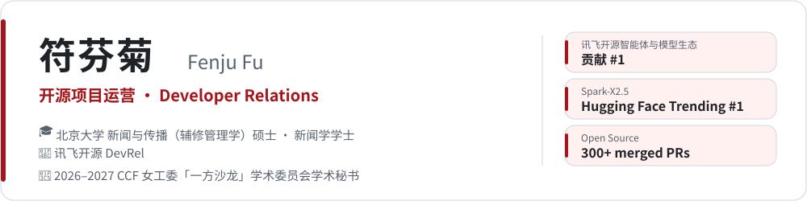
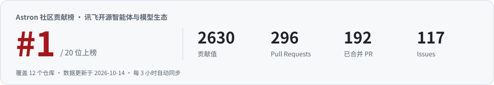

<a href="https://github.com/FenjuFu">English</a> · <b>中文</b>

<picture>
  <source media="(prefers-color-scheme: dark)" srcset="assets/header-zh-dark.svg">
  
</picture>

  
  
  

## 🚀 讯飞开源 · iFlytek Open Source

<!-- astron-rank:start -->
🥇 **讯飞开源智能体与模型生态贡献 #1** · [Astron 社区贡献榜](https://www.awesome-astron-workflow.dev/stats)
<!-- astron-rank:end -->

<a href="https://www.awesome-astron-workflow.dev/stats">
  <picture>
    <source media="(prefers-color-scheme: dark)" srcset="assets/rank-zh-dark.svg">
    
  </picture>
</a>

参与运营的项目：[Astron Agent](https://github.com/iflytek/astron-agent)  · [Astron RPA](https://github.com/iflytek/astron-rpa)  · [SkillHub](https://github.com/iflytek/skillhub)  · [Spark-X2.5](https://github.com/XHToken/Spark-X2.5)

| 时间 | 项目 | 里程碑 |
| :-- | :-- | :-- |
| 2026.09.29 | Spark-X2.5 | 分发渠道 + 社区量化 / 微调合计下载突破 **100 万** |
| 2026.09.15 | Astron Agent | 接入 Linux Foundation [LFX Insights](https://insights.linuxfoundation.org/project/astron-agent) |
| 2026.09.11 | Spark-X2.5 | 金算奖 · 端侧智能创新奖 |
| 2026.09.07 | Spark-X2.5 | **Hugging Face Trending #1** |
| 2026.08.28 | Astron Agent | 2026 AI-FDE 赋能制造业大会 · 制造业 AI 原生应用标杆 |
| 2026.07.16 | Astron Agent | 进入 **CNCF 云原生全景图**（AI Native — Workflow Orchestration） |
| 2026.07.14 | SkillHub | 加入 **Agentic AI Foundation（AAIF）**，成为 Associate Member |
| 2026.05.30 | SkillHub | GitHub Trending #2 |
| 2026.05.20 | Astron Agent | 量子位「2026 中国 AIGC 最值得关注的企业 & 产品」 |
| 2026.04.04 | Astron RPA | GitHub Trending #2 |
| 2026.04.03 | Astron Agent | **GitHub Trending #1** · Repository of the Day |
| 2026.03.28 | Astron RPA | OS2ATC 2026 最佳开源智能突破奖 |
| 2026.03 – 08 | SkillHub | OSS Insight 全球 Java 趋势 TOP 5 |
| 2026.02 | Astron Agent | OpenRank 值 · 中国 Agent 第一 |
| 2026.01.29 | Astron 生态 | Gitee 2025 年度开源项目「人工智能 TOP 10」 |
| 2026.01 – 06 | Astron RPA | OSS Insight 全球 Java 趋势 TOP 10 |
| 2026.01 – 02 | Astron RPA | OpenLeaderboard · 中国 RPA 第一 |
| 2025.09 – 2026.08 | Astron Agent | OSS Insight 全球 Java 趋势 TOP 5 |
| 2025.09 – 2026.01 | Astron Agent | OpenLeaderboard 活跃度 · 中国 Agent 第一 |

来源：[讯飞开源里程碑](https://opensource.iflytek.com/milestone)

## 🌍 上游开源贡献 · Upstream Contributions

把讯飞模型接进海内外开源生态，顺手修掉沿途遇到的 bug。部分已合并 PR：

| 方向 | 已合并 PR |
| :-- | :-- |
| 🔌 **模型生态互通** iFlytek Spark / Astron provider | [aaif-goose/goose#9837](https://github.com/aaif-goose/goose/pull/9837) · [dapr/dapr-agents#672](https://github.com/dapr/dapr-agents/pull/672) · [alibaba/open-code-review#485](https://github.com/alibaba/open-code-review/pull/485) · [deepset-ai/haystack-integrations#543](https://github.com/deepset-ai/haystack-integrations/pull/543) · [HKUDS/Vibe-Trading#537](https://github.com/HKUDS/Vibe-Trading/pull/537) · [harry0703/MoneyPrinterTurbo#1531](https://github.com/harry0703/MoneyPrinterTurbo/pull/1531) · [thedotmack/claude-mem#4379](https://github.com/thedotmack/claude-mem/pull/4379) · [TencentCloud/octop-harness#25](https://github.com/TencentCloud/octop-harness/pull/25) |
| 🛠️ **Bug 修复与工程** C++ / Rust / Go / Python | [fmtlib/fmt#4962](https://github.com/fmtlib/fmt/pull/4962) · [agentgateway/agentgateway#2915](https://github.com/agentgateway/agentgateway/pull/2915) · [agentgateway/agentgateway#2839](https://github.com/agentgateway/agentgateway/pull/2839) · [NVIDIA/SkillSpector#708](https://github.com/NVIDIA/SkillSpector/pull/708) · [longbridge/gpui-kit#3344](https://github.com/longbridge/gpui-kit/pull/3344) · [stablyai/orca#24005](https://github.com/stablyai/orca/pull/24005) · [vectorize-io/hindsight#4927](https://github.com/vectorize-io/hindsight/pull/4927) · [tailscale/tailcat#34](https://github.com/tailscale/tailcat/pull/34) · [abhigyanpatwari/GitNexus#3100](https://github.com/abhigyanpatwari/GitNexus/pull/3100) · [Tencent/teamai-cli#482](https://github.com/Tencent/teamai-cli/pull/482) |
| 🪶 **Apache 基金会** | [apache/seatunnel#11664](https://github.com/apache/seatunnel/pull/11664) · [apache/seatunnel#11836](https://github.com/apache/seatunnel/pull/11836) · [apache/fineract-backoffice-ui#533](https://github.com/apache/fineract-backoffice-ui/pull/533) · [apache/fineract-backoffice-ui#540](https://github.com/apache/fineract-backoffice-ui/pull/540) · [apache/magpie#896](https://github.com/apache/magpie/pull/896) |
| 📚 **文档与教程** | [modelcontextprotocol/modelcontextprotocol#2978](https://github.com/modelcontextprotocol/modelcontextprotocol/pull/2978) · [JetBrains/go-modern-guidelines#26](https://github.com/JetBrains/go-modern-guidelines/pull/26) · [trycua/cua#4380](https://github.com/trycua/cua/pull/4380) · [max-sixty/worktrunk#4332](https://github.com/max-sixty/worktrunk/pull/4332) · [pingcap/ossinsight#2897](https://github.com/pingcap/ossinsight/pull/2897) · [datawhalechina/deepagents-in-action#138](https://github.com/datawhalechina/deepagents-in-action/pull/138) |

👉 [查看全部已合并 PR](https://github.com/search?q=author%3AFenjuFu+is%3Apr+is%3Amerged&type=pullrequests)

## 🏆 荣誉 · Honors

| 年份 | 荣誉 |
| :-- | :-- |
| 2026–2027 | CCF 女工委「计算之美·一方沙龙」学术委员会学术秘书 |
| 2025 | CCF 技术公益案例集优秀案例 |
| 2024 · 2025 | 开源社 OpenGood 开源公益优秀案例 |
| — | 中国计算机协会（CCF）技术公益、开源社 OpenGood 开源公益大使 |
| 2024 | 中国互联网发展创新与投资大赛（开源）二等奖项目 OpenTenBase 核心贡献者 |
| 2024 | 源译识 · 年度贡献者 |
| 2023 | 开放原子校源行开源大使 |

## 🧭 专长 · Expertise

       

---

📬 合作、演讲与交流：<a href="mailto:fufenjupku@gmail.com">fufenjupku@gmail.com</a>

